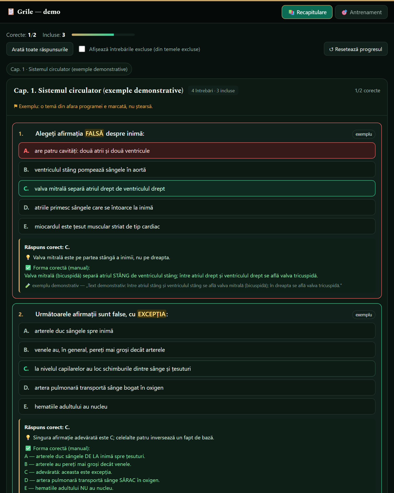
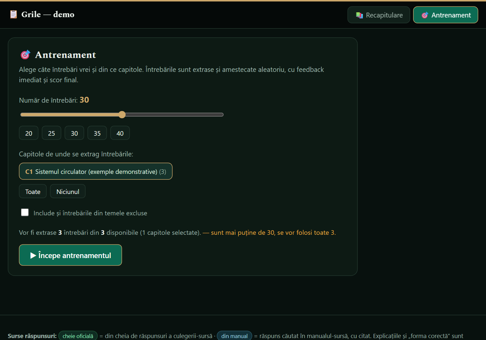

# Admission quiz pipeline

**From 195 phone photos of a printed test booklet to an offline quiz app with explanations — and an automatic check that caught errors a human reviewer missed.**

I built this to prepare for my own admission exam at a Romanian medical university (anatomy & physiology, 2026). The booklet came only on paper. The result was a single HTML file that runs offline on a phone: 495 questions, the official answer key, an explanation for each question backed by a quote from the textbook, and a training mode with random tests.



> The questions and textbook quotes from the real run are third-party copyrighted material, so they are **not** in this repository. `sample/` holds four demonstration questions I wrote myself, in the same format. The full app can be shown live on request.

## What it does

```
photos ──▶ extraction ──▶ merge & checks ──▶ enrichment ──▶ build ──▶ audit
 (195)     (LLM vision)    merge_ocr.py      (LLM + quote)   build_quiz.py  audit_fix.py
```

1. **Extraction** — each page photo was read by an LLM (Claude, run as parallel sub-agents in batches) into structured JSON: chapter header, question number, stem, five options, and the answer-key tables printed at the end of the booklet. Anything unreadable is marked `[?]` instead of guessed.
2. **Merge & checks** (`pipeline/merge_ocr.py`, deterministic) — walks the pages in order, carries the current chapter forward (most pages have no header), joins the answer key back to each question, and reports missing pages, numbering gaps, duplicates, illegible text and questions without a key. Illegible items were fixed by hand from the full-resolution photo.
3. **Enrichment** — for every question: the syllabus sub-section, whether that sub-section is in the exam syllabus, a **verbatim** quote from the textbook with its page number, a short explanation, and for false statements the corrected form. The rule was "quote or leave empty — never invent a citation".
4. **Build** (`pipeline/build_quiz.py`) — joins questions and enrichment, writes a data snapshot, and injects it into a self-contained HTML template (`app/quiz_template.html`, no server, progress saved in the browser).
5. **Audit** (`pipeline/audit_fix.py`) — cross-checks every corrected statement against the official key and fails the build on a contradiction.

## Results of the real run

| | |
|---|---|
| Photos processed | 195 |
| Questions extracted | 495 in 8 chapters |
| In the exam syllabus / outside it (kept, marked, toggleable) | 423 / 72 |
| Questions with a textbook quote | 481 |
| Questions with a corrected statement | 150 |

**Two errors found, both by checking against a fixed reference rather than by re-reading:**

- **In the official answer key.** One question's printed key contradicted the textbook (it swapped two structures). The textbook passage was quoted to confirm the correct answer; the question was kept, with the explanation shown.
- **In the LLM-generated enrichment.** For questions of the form *"all false, EXCEPT one"*, the enrichment step had "corrected" the one statement that was actually true. The fix contradicted the official key. I wrote `audit_fix.py` to catch the two shapes this takes (the keyed letter argued false; a different letter crowned correct), ran it over all 150 corrected statements, found exactly that one, fixed it at the source data, and kept the audit as a permanent gate.

## Run it

Python 3.10+, no dependencies for the pipeline; `pytest` for the tests.

```bash
python pipeline/build_quiz.py --data sample --out build/quiz.html --title "Grile — demo"
python pipeline/audit_fix.py build/quiz_data.json     # exit code 1 on a contradiction
python -m pytest -q
```

Open `build/quiz.html` in any browser. The app UI is in Romanian.



## Repository layout

```
app/quiz_template.html   offline quiz app (HTML + vanilla JS), data injected at build time
pipeline/merge_ocr.py    page batches -> chapter-ordered questions + answer key, with checks
pipeline/build_quiz.py   questions + enrichment -> quiz HTML + data snapshot
pipeline/audit_fix.py    corrected statements vs. official key
sample/                  four original demo questions in the real data format
tests/                   pipeline tests
```

## What I would do differently

The extraction and enrichment prompts were run interactively and are not versioned here; in a second version I would store them next to the code and record which model produced each field. I would also run the audit automatically after every enrichment batch instead of after the full run.

## License

Code: MIT. The demo questions in `sample/` are original and may be reused freely.
